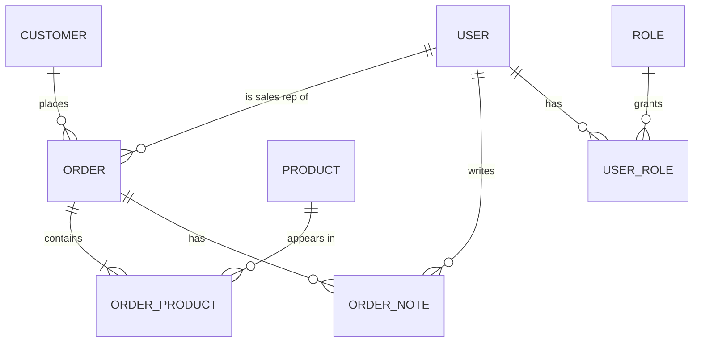

# learning-core-api

**A hands-on EF Core performance course in runnable code** (.NET 10 + PostgreSQL in Docker).

Every lesson takes one real-world problem, shows the **slow way** (`Naive.cs`) next to the **fast way**
(`Fixed.cs`), and proves the difference with numbers: how many queries were sent, how long it took, and
that both versions return the same result. Use it as a tutorial, a quick reference, or interview prep.

> Techniques covered include `AsNoTracking()`, `AsSplitQuery()`, projections, N+1 fixes, keyset pagination,
> indexes, compiled queries, bulk writes, optimistic concurrency, the transactional outbox and more
> (see the roadmap below).

## Quick start

Requirements: [.NET 10 SDK](https://dotnet.microsoft.com/download) and Docker.

```bash
docker compose up -d            # start Postgres (once per session)
cd lessons/00-setup-check
dotnet run                      # first run builds and seeds the database (a minute or two, once)
```

You should see a small table comparing **Naive** and **Fixed**. If you do, everything works.

## How a lesson works

```
lessons/03-n-plus-one/
├── README.md     the problem, the concept, what to look for, interview Q&A
├── Naive.cs      the version most people write first
├── Fixed.cs      the optimized version  (in guided mode: a TODO for you to implement)
└── Program.cs    three lines that hand Naive and Fixed to the shared runner
```

```bash
cd lessons/03-n-plus-one
dotnet run                  # runs Naive, then Fixed, prints queries / time / rows
dotnet run -- --sql         # ...and shows the SQL EF generated
```

Example of the output format (numbers will differ on your machine):

```
Variant   Queries    Time (ms)         Rows  Result
Naive           8         41.2    1,234,567  baseline
Fixed           1          5.3    1,234,567  OK - same result as Naive

Queries: 8 -> 1    Time: 41.2 ms -> 5.3 ms (7.8x faster)
```

The runner also **checks that Fixed returns the same result as Naive**, so a "fast" version that quietly
returns the wrong data is reported as `WRONG`, not as a win.

## Runner options

Put them after `--`:

| Option | What it does |
|---|---|
| `--sql` | Also print the SQL each variant sent to the database |
| `--reset` | Restore the working database from the baseline, then exit |
| `--reseed` | Delete and rebuild the baseline from scratch, then exit |
| `--small` | With `--reseed`: build the small dataset (20k orders) instead of the large one (200k) |
| `--no-warmup` | Skip the discarded warm-up run (timings then include JIT and cold caches) |
| `--help` | Show the options |

## The data

All lessons share one schema and one deterministic dataset, so results are comparable between lessons
and between machines.



| Table | Rows (large) |
|---|---|
| customers | 10,000 |
| products | 1,000 |
| orders | 200,000 |
| order_products (lines) | ~600,000 |
| order_notes | ~400,000 |
| users / roles / user_roles | 50 / 4 / 50 |

Ids are time-ordered GUIDs (`Guid.CreateVersion7()`). `User` has a global soft-delete query filter, `audit_logs` and
`message_queue` tables exist for the observability and outbox lessons.

### Resetting data

Two databases live in the Docker Postgres:

- `efcorelab_baseline` - the golden copy, built once (schema + seed + `VACUUM ANALYZE`), never touched by lessons.
- `efcorelab` - the working copy lessons run against.

A reset drops the working database and copies the baseline (`CREATE DATABASE ... TEMPLATE ...`), which takes
seconds even for 200k orders. If a first-time build is interrupted (Ctrl+C), run `--reseed` once to start clean. Lessons that change data or schema are reset automatically before each variant
and afterwards, so you can run any lesson any number of times.

```bash
dotnet run -- --reset           # back to the baseline now
dotnet run -- --reseed          # rebuild the baseline (e.g. after changing the seeder)
dotnet run -- --reseed --small  # ...with the small dataset (20k orders) for quick experiments
docker compose down -v          # nuclear option: delete everything, including the volume
```

Connection settings: the defaults match `docker-compose.yaml`; override with the `EFLAB_CONNECTION`
environment variable. The compose file binds to `127.0.0.1:5433` only and uses throwaway lab credentials.

## Roadmap

| # | Lesson | Status |
|---|---|---|
| 00 | [Setup check](lessons/00-setup-check) - 8 queries vs 1 | done |
| 01 | [Change tracking and `AsNoTracking()`](lessons/01-tracking) | ready - your turn: `Fixed.cs` |
| 02 | [Projection with `Select`](lessons/02-projection) | ready - your turn: `Fixed.cs` |
| 03 | The N+1 problem | planned |
| 04 | Cartesian explosion and `AsSplitQuery()` | planned |
| 05 | Pagination: offset vs keyset | planned |
| 06 | Indexes (verified with `EXPLAIN ANALYZE`) | planned |
| 07 | Client vs server evaluation | planned |
| 08 | Compiled queries | planned |
| 09 | Filtered `Include` and raw SQL | planned |
| 10 | Bulk writes: `AddRange` vs `ExecuteUpdate` / `ExecuteDelete` | planned |
| 11 | Optimistic concurrency | planned |
| 12 | Transactional outbox | planned |
| 13 | Soft delete with global query filters | planned |
| 14 | DbContext pooling and `IDbContextFactory` | planned |
| 15 | Observability: slow-query logging and interceptors | planned |

## Repository layout

```
learning-core-api/
├── docker-compose.yaml            Postgres for the lab (port 5433)
├── learning-core-api.slnx
└── lessons/
    ├── Directory.Build.props      shared settings; every lesson references EfCoreLab.Common
    ├── EfCoreLab.Common/          entities, DbContext, seeder, database reset, lesson runner
    └── 00-setup-check/ ...        one small console project per lesson
```

The original API this repository used to contain is preserved in git under the tag `api-final`.
